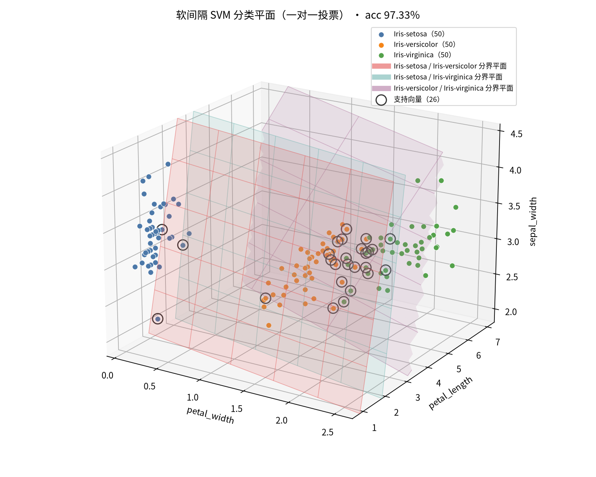
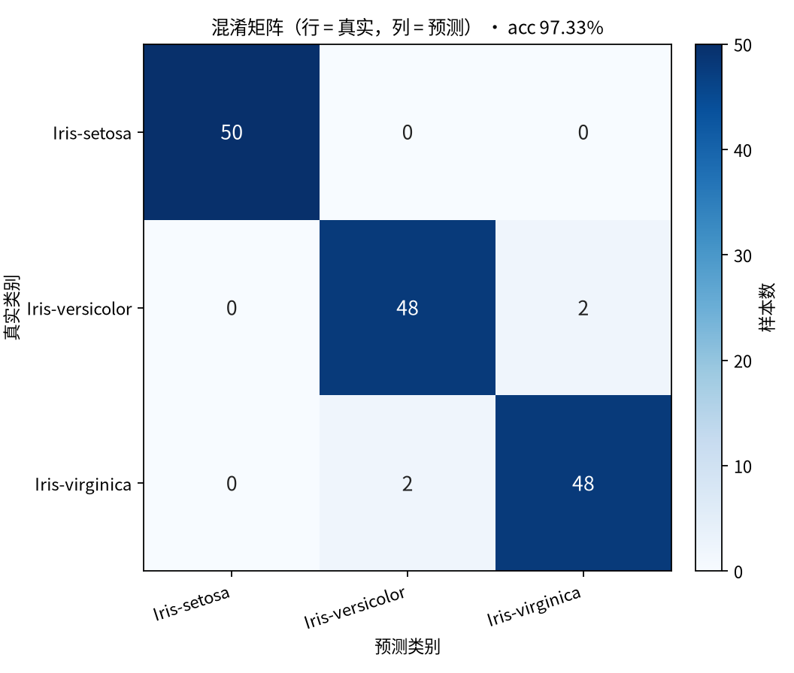
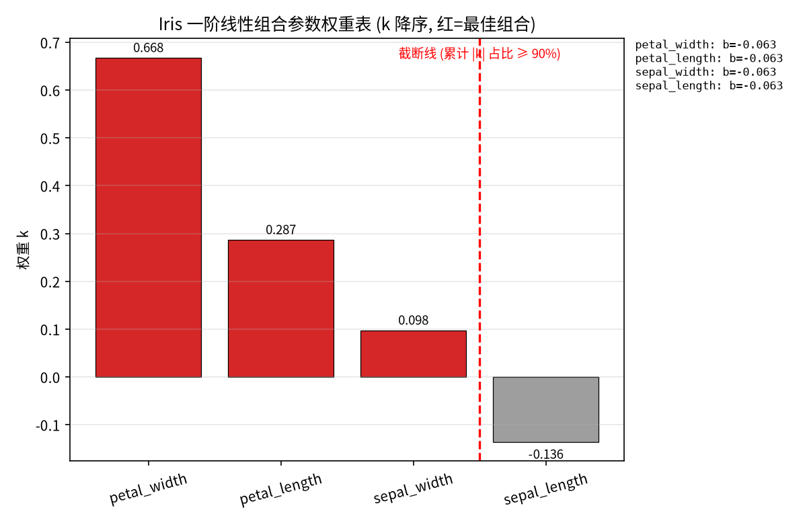
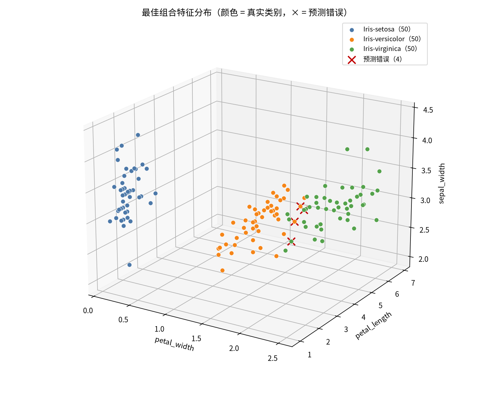
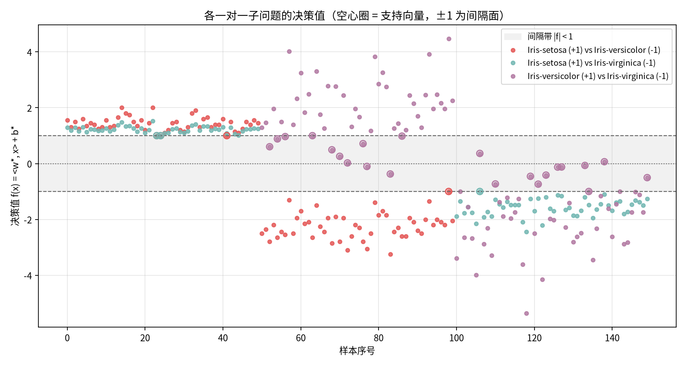

# LRIS — Iris 数据的「一阶线性组合 + 反向传播」参数筛选

用一阶线性组合 `y = Σ(kᵢ·xᵢ + bᵢ)` 拟合 Iris 三个类别，通过反向传播调整 4 组参数
`(kᵢ, bᵢ)`，再把权重降序排列、按 `|k|` 累计占比达到 90% 截断，得到**最佳参数组合**。

依赖用 [uv](https://docs.astral.sh/uv/) 管理（已在 `pyproject.toml` 配置清华 TUNA 镜像源）。

> 阅读顺序：**一、最终得到的决策函数**（先看结论）→ 快速开始 / 数据 → 二、原理 → 三、验证与关键发现 → 四、输出 → 五、配置项。

# 一、最终得到的决策函数

> 先看结论：这一节就是整个项目的最终产物。后面的「二、原理 / 三、验证」只是在讲这些数字是怎么来的。

`main.py` 的计算阶段（`--stage compute` / 默认 `all`）训练完会直接打印这一节内容：
每个「类别对」一条 `f(x) = <w*, x> + b*`，再加一条投票规则，合起来就是最终分类器。

## 1. 变量顺序

`w*` 的分量顺序 = `best_params` 的顺序（**不是** `iris.data` 的列序）：

```
x = (petal_width, petal_length, sepal_width)
```

> 当前 `best_params.jsonc` 的 `coverage_threshold = 0.85`，只保留前 3 个特征；
> 按「二、原理 → 5. 最佳参数组合筛选」里的 0.90 阈值则 `sepal_length` 会一起入选（4 维）。
> 特征集一变，`w*` / `b*` 需要重新训练，下面的数值随之变化。

## 2. 三张分类平面（当前训练结果，C = 1.0）

软间隔 SVM 用一对一（one-vs-one）拆分：3 个类别 → 3 个二分类子问题，每个子问题给出一个平面 `f_k(x) = <w*_k, x> + b*_k`。

```
f_01(x) = -0.5·petal_width - 1·petal_length + 0.5·sepal_width + 1.3
          → f > 0 判 Iris-setosa，f < 0 判 Iris-versicolor

f_02(x) = -0.2968·petal_width - 0.5355·petal_length + 0.1804·sepal_width + 1.4634
          → f > 0 判 Iris-setosa，f < 0 判 Iris-virginica

f_12(x) = -2.1·petal_width - 1.9·petal_length + 0.9667·sepal_width + 10.0667
          → f > 0 判 Iris-versicolor，f < 0 判 Iris-virginica
```

| 子问题（+1 vs −1） | `w*`（petal_width, petal_length, sepal_width） | `b*` | 支持向量 / 自由 SV |
|---|---|---|---|
| Iris-setosa vs Iris-versicolor | −0.500046, −0.999992, 0.500006 | 1.299991 | 4 / 4 |
| Iris-setosa vs Iris-virginica | −0.296828, −0.535521, 0.180432 | 1.463378 | 3 / 3 |
| Iris-versicolor vs Iris-virginica | −2.100000, −1.900000, 0.966667 | 10.066667 | 22 / 2 |



*图 1　三维分类平面（`./figures/decision_planes_3d.png`）：`x = (petal_width, petal_length, sepal_width)` 三维散点，
按真实类别着色；三个半透明面分别是 `f_01`、`f_02`、`f_12` 的零平面，空心大圈为支持向量（共 26 个），
标题标注训练集正确率 97.33%。*

## 3. 投票规则

```
vote_c(x) = Σ_k [ f_k(x) > 0 ? 正类_k == c : 负类_k == c ]      # 每个平面给"它判定的那一类"投 1 票
ŷ(x)      = argmax_c vote_c(x)
```

平票兜底（`1:1:1` 这类情况）：比较各平面 `Σ(±f_k(x))` 的代数和（胜出方向的 `f_k` 取正），取最大者，
避免退化成「按类别号取首个」。Iris 三类时每个样本最多 3 票，正常不会平票，但类别数更多的数据会。

## 4. 验算（第 1 行样本）

`x = (petal_width=0.2, petal_length=1.4, sepal_width=3.5)`

```
f_01(x) = +1.5500   → 投 Iris-setosa
f_02(x) = +1.2858   → 投 Iris-setosa
f_12(x) = +10.3700  → 投 Iris-versicolor
票数 = {Iris-setosa: 2, Iris-versicolor: 1, Iris-virginica: 0} → 预测 Iris-setosa（真实 Iris-setosa）
```

全部 150 个样本按此规则预测，正确率 **97.33%（146/150）**：2 个 versicolor 被判成 virginica、
2 个 virginica 被判成 versicolor，其余全对。



*图 2　混淆矩阵（`./figures/confusion_matrix.png`）：行 = 真实类别，列 = 预测类别。
对角线 50 / 48 / 48，错分只发生在 versicolor ↔ virginica 之间（各 2 例），setosa 全部正确。*

## 5. 代码位置与调用方式

| 位置 | 作用 |
|---|---|
| `SVMDual.decision` | 单个平面的 `f(x) = <w*, x> + b*`（向量化） |
| `classification_Decision` | 组装全部平面、算决策值 `scores`、一对一投票得 `prediction` |
| `decision_function(w, b, x)` | 最终决策函数的单样本求值 |
| `format_decision_function(w, b, names)` | 把 `f(x)` 渲染成带具体数值的式子（上面那些公式就是它打出来的） |
| `predict_sample(model, x)` | 最终决策函数：单样本走完整条规则（3 个平面 + 投票），返回类别下标 |
| `print_decision_function(state, params, dataset)` | 打印本节全部内容（式子 + 投票规则 + 一条代入验算） |

```python
from main import INDEX_TO_LABEL, load_best_params, load_iris_data, predict_sample, run_computation

params = load_best_params()                 # 读 best_params.jsonc
dataset = load_iris_data()                  # 读 iris.data
state = run_computation(dataset, params)    # 计算阶段：SMO 解 α* → 还原 w*/b* → 投票

# 列顺序 = best_params 顺序：petal_width, petal_length, sepal_width
label = predict_sample(state["model"], (0.2, 1.4, 3.5))
print(INDEX_TO_LABEL[label])                # → Iris-setosa
```

> `predict_sample` 内部直接复用 `classification_Decision`（把单样本拼成只有一行的 `X`），
> 所以「打印出来的公式」与「程序真正执行的规则」是同一份实现，不会各写一套而悄悄跑偏。

---

## 快速开始

```bash
uv sync      # 安装依赖
uv run lris  # 训练 + 筛选 + 出图 + 缓存
```

## 数据

`iris.data`：UCI Iris，150 行，4 特征 + 1 标签，三类各 50 条。

| 字段 | 含义 | 标签编码 |
|---|---|---|
| sepal_length | 花萼长度 | Iris-setosa → **0** |
| sepal_width | 花萼宽度 | Iris-versicolor → **1** |
| petal_length | 花瓣长度 | Iris-virginica → **2** |
| petal_width | 花瓣宽度 | |

---

# 二、原理

## 1. 模型

```
y = Σᵢ (kᵢ·xᵢ + bᵢ) = X·k + Σb        k、b 初始值均为 1
```

4 个特征各配一组 `(kᵢ, bᵢ)`，共 4 组参数、8 个自由度。输出 `y` 是连续标量。

## 2. 量化标签与间隔 s

连续输出要映射回 0/1/2 三个标签，需要定义三个量化等级。

**间隔 s 由数据自动决定，不做归一化**：

```
s = 4 个特征方差的平均值           （本数据 ≈ 1.1347）
量化等级 = 0 / s / 2s，相邻间距 = s
量化映射 q = clip( round(y / s), 0, 2 )
```

**关键：回归目标必须同步为 `target = t·s`**（即 0 / s / 2s）。

这样设计有两个好处：

1. **量化自洽**：类别中心正好落在 0/s/2s 三个等级上，`round(y/s)` 天然判对。
2. **有效斜率随 s 放大**：最小二乘平衡解满足 `k* ∝ s`，s 越大有效参数斜率 `k` 越大，
   而 s 完全由数据方差决定，无需人工设定，也无需归一化。

## 3. 反向传播：「先 b 后 k」

损失为 MSE，全批量梯度下降：

```
L = (1/n)·Σ (y − target)²
∂L/∂b = (2/n)·Σ(y − target)
∂L/∂k = (2/n)·Xᵀ·(y − target)
```

每次更新严格按「**先调 b → 用新 b 重新前向 → 再调 k**」的顺序执行。

## 4. 动态学习率（线搜索）

学习率按「**误差 ÷ 梯度**」的量纲自动确定，并由线搜索取当前方向的最优值：

```
k 方向: lr_k = (e² ᵀ X·dk) / ‖X·dk‖²
b 方向: lr_B = sum(e) / (4·n·g_B)
```

无需任何手调超参数。每轮内交替执行 `DYN_INNER` 次（默认 20）以克服 b/k 强耦合。

## 5. 最佳参数组合筛选

1. 把 4 个 `k` **降序**排列，取绝对值 `|k|` 参与累计；
2. 计算每一项的占比 `|kᵢ| / Σ|k|`，并求前缀累计占比；
3. 在**累计占比首次达到 90%** 处截断，且**包含跨过阈值的那一项**；
4. **截断前即为最佳参数组合**，其覆盖率（入选 `|k|` 之和 / 全部 `|k|` 之和）恒 ≥ 90%。

依据：按权重强弱累计，占比之和达到 90% 的前若干项就解释了绝大部分输出，
剩下的特征贡献不足 10%，可视为冗余。用 `|k|` 而非 `k` 是因为权重可能为负
（本数据 `sepal_length` 的 k 为负），直接累加会让正负抵消。

阈值由 `WEIGHT_COVERAGE` 控制（默认 `0.90`）。

实测（当前 k 的 `|k|` 降序）：

| 名次 | 特征 | `\|k\|` | 占比 | 累计占比 |
|---|---|---|---|---|
| #1 | petal_width | 0.6677 | 56.19% | 56.19% |
| #2 | petal_length | 0.2869 | 24.14% | 80.34% |
| #3 | sepal_width | 0.0976 | 8.21% | 88.55% |
| #4 | sepal_length | 0.1361 | 11.45% | **100.00% ← 达到 90%，截断处** |

前三项仅累计到 88.55%，所以 90% 阈值下 **4 个特征全部入选**（未剔除任何特征）；
若想只保留主导特征，可把 `WEIGHT_COVERAGE` 调到 0.88 以下（例：0.85 → 保留前 3 项）。


---

# 三、验证与关键发现

以下结论均由实测得到，标注了具体数据。

## 发现 1：学习率 0.7 必然发散（数学必然）

MSE 对参数是二次函数，沿任一方向的更新是：

```
e_new = (1 − η·2a)·e        收敛要求 η < 1/a，  a ∝ E[x²]
```

本数据 `E[x²]`：sepal_length ≈ 35.4、petal_length ≈ 17.2，联合曲率 λ ≈ 70~130，
**稳定上界 η < 2/130 ≈ 0.015**。而 η = 0.7：

```
放大因子 = 1 − 2·35.4·0.7 = −48.6     每轮放大 48 倍且符号翻转
```

实测（lr=0.7）：

| epoch | loss | max\|Δk\| |
|---|---|---|
| 1 | 289.79 | 902 |
| 2 | 4.11e7 | 3.4e5 |
| 3 | 5.70e12 | 8.8e7 |

**第 120 轮溢出为 inf**。结论：`lr` 取值与特征量纲强相关，不能凭直觉设大。

## 发现 2：梯度裁剪救不了发散

裁剪把每步位移限制为 `lr × clip`，等价于变相压低学习率：

| 配置 | 轮数 | 正确率 | k 终值 |
|---|---|---|---|
| lr=0.7 clip=5.0 | 5000 | 0.333 | 周期 2 极限环，转回起点 |
| lr=0.7 clip=1.0 | 5000 | 0.333 | 周期震荡 |
| lr=0.7 clip=0.1 | 5000 | 0.333 | 周期震荡 |
| lr=0.7 clip=0.02 | 5000 | 0.647 | 勉强收敛即等效 lr≈0.014 |

要收敛就得 clip ≈ 0.02，此时实际学习率仅 0.0144——**裁剪不是修复，只是隐式降 lr**。

## 发现 3：量化间隔必须与回归目标对齐

同一个收敛解，只改量化方式，正确率差异巨大：

| 方案 | 间隔 s | 量化式 | 回归目标 | 正确率 |
|---|---|---|---|---|
| 原始 | 1.1347（方差均值） | `floor(y/s)` | `t` | **0.560** |
| 改间隔 | 1.0（标签间距） | `floor(y/s)` | `t` | 0.693 |
| **本方案** | **1.1347（方差均值）** | **`round(y/s)`** | **`t·s`** | **0.973** ✓ |

原因：标签 0/1/2 的 `y` 均值是 **−0.028 / 1.193 / 1.833**。
若量化区间是 `[0, s) / [s, 2s) / [2s, ∞)` 且 s = 1.1347，则 virginica（y≈1.833）
落在 `[1.135, 2.269)` 里被判为 1，必然错；而把等级改为 0/s/2s 并对齐目标后即自洽。

## 发现 4：动态学习率应是 `e ÷ g`，不是 `e × g`

二次损失下 `g = H·e`，两者的步长量纲完全不同：

| 写法 | 步长 | 随误差衰减 | 靠近解时 |
|---|---|---|---|
| 静态 `lr·g` | ∝ e¹ | 线性 | 正常 |
| **`e × g`** | **∝ e³** | **立方** | **严重停滞** |
| **`e ÷ g`** | **∝ e⁰** | 恒定 | 正常/一步到位 |

首轮真实数据：`e=16.72`、`g_b=133.76`，而 `b` 全程只需移动 `0.34`

```
e × g = 2236    ← 爆炸 6500 倍，直接用 3 轮内发散
e ÷ g = 0.125   ← 与 0.34 同量级，正确
```

收敛速度实测（目标 85%）：

| 方案 | 轮数 |
|---|---|
| `e × g`（加定标常数） | 8922 |
| `e ÷ g` 线搜索 | 115（**快 77 倍**） |
| `e ÷ g` + 每轮内交替 20 次 | **6**（比静态快 5 倍） |

## 发现 5：b/k 强耦合，坐标式更新偏慢

`petal_length` 与 `petal_width` 相关系数高达 **0.96**，b 与 k 也互相牵制。
单纯「先 b 后 k」每轮只交替一次时，收敛较慢：

| 每轮内交替次数 | 轮数（到 85%） |
|---|---|
| 1 | 115 |
| 2 | 58 |
| 5 | 23 |
| 10 | 12 |
| **20（默认）** | **6** |
| 50 | 3（90.67%） |

因此保留「先 b 后 k」顺序，但在一轮内多交替几次。

## 发现 6：完全收敛时动态优于静态

按**更新次数**公平比较（都收敛到同一最优解）：

| 模式 | 轮数 | 更新次数 | 最终 acc |
|---|---|---|---|
| 静态 lr=0.01 | 1563 | 1563 | 97.33% |
| **动态线搜索（交替 1 次）** | 766 | **766** | 97.33% |
| 动态线搜索（交替 5 次） | 160 | 800 | 97.33% |
| 动态线搜索（交替 20 次） | **43** | 860 | 97.33% |

同一精度下动态**少用一半更新次数**；按轮数计 `inner=20` 比静态快 **36 倍**。

> 注：静态版看似「31 轮就达标」，是因为它停在 87.3% 的较早位置；
> 到同一精度时动态明显更优，这才是公平比较。

## 发现 7：算法正确性 —— 与解析解逐位一致

完全收敛的解与最小二乘解析解完全吻合，证明反向传播实现无误：

```
收敛解  k = [-0.1245, -0.0502, 0.2576, 0.6921]   b = 0.0545
解析解  k = [-0.1245, -0.0502, 0.2576, 0.6921]   bias = 0.0545   ✓
```

## 发现 8：模型形式的正确率上限约 98%

扫描最优双阈值得到上限 **98%**，故 85% 目标可达。
但 MSE 回归会把预测值向均值**收缩（shrinkage）**，追求平方误差最小而非分类边界最优，
因此完全收敛时为 97.33%，略低于理论上限。


---

# 四、输出

所有产物分两类：**缓存 + 权重图**在仓库根目录，**可视化图表**统一在 `./figures/`。

## 1. 根目录

| 文件 | 说明 |
|---|---|
| `best_params.jsonc` | **最佳参数组合缓存**（JSONC，带字段注释），只保存截断后的有效参数（含 k/b、截断依据、正确率等） |
| `iris_weights.png` | 权重表柱状图：k 降序，最佳组合红色高亮，截断处红色虚线（`iris_model.plot_weights` 输出，路径常量 `OUT_PNG`） |



*图 3　权重表（`./iris_weights.png`）：4 个特征的 `k` 按降序排列，红色 = 入选的最佳组合，
红色虚线为截断位置（累计 `|k| ≥ 90%`），柱顶标注 `k` 值，右侧列出各特征的 `b`。*

## 2. `./figures/` —— 图表输出目录

图表阶段（`uv run lris` / `python main.py` 的最后一步，也可单独 `python main.py --stage charts`）会把 4 张图统一写进 **`./figures/`**：
目录由 `main.py` 的 `FIGURES_DIR = ROOT / "figures"` 决定，不存在会自动创建；每张图 dpi=160。

| 文件 | 说明 |
|---|---|
| `./figures/features_scatter_3d.png` | 三维特征散点：最佳组合的 3 个特征，按真实类别着色，预测错误的样本用 `×` 标出 |
| `./figures/decision_planes_3d.png` | 三维分类平面：样本散点 + 每个一对一子问题的平面 `<w*, x> + b* = 0` + 支持向量 |
| `./figures/decision_scores.png` | 决策值分布：各子问题的 `f(x)`，`\|f\| < 1` 落在间隔内部（间隔亏欠），空心圈为支持向量 |
| `./figures/confusion_matrix.png` | 3×3 混淆矩阵热图（含数值标注）：行 = 真实类别，列 = 预测类别 |



*图 4　三维特征散点（`./figures/features_scatter_3d.png`）：最佳组合的 3 个特征，按真实类别着色，
红色 `×` 为预测错误的 4 个样本（全部落在 versicolor / virginica 交界处）。*



*图 5　决策值分布（`./figures/decision_scores.png`）：横轴样本序号、纵轴各子问题的 `f(x)`；
灰色带 `|f| < 1` 为间隔内部（间隔亏欠），空心圈为支持向量，`f = 0` 为零平面。
setosa 相关的两个子问题几乎全部落在 `f > 1` 一侧，说明这三类里 setosa 最易分。*

> 另有 `./figures/decision_planes_3d.png` 与 `./figures/confusion_matrix.png` 已就近展示在
> 「[一、2 三张分类平面](#2-三张分类平面当前训练结果c--10)」与「[一、4 验算](#4-验算第-1-行样本)」两节。

运行时终端会直接打印这批图的落盘路径（未安装 matplotlib 时整段自动跳过并提示先 `uv sync`）：

```
  5) 图表阶段 —— 三维分类平面可视化
  输出目录  : /path/to/lris/figures
  中文字体  : Noto Sans CJK SC
  图像后端  : Agg

[ok] 三维特征散点: 已保存 /path/to/lris/figures/features_scatter_3d.png
[ok] 三维分类平面: 已保存 /path/to/lris/figures/decision_planes_3d.png
[ok] 决策值分布: 已保存 /path/to/lris/figures/decision_scores.png
[ok] 混淆矩阵: 已保存 /path/to/lris/figures/confusion_matrix.png
```

## 3. `best_params.jsonc` 的字段约定

`best_params.jsonc` **只存截断后的有效参数**：`best_params` 与 `ranking` 都只含入选特征，
被截断掉的特征不会出现在任何 k/b 字段里；截断依据单独记为 `coverage_threshold`（占比阈值）
与 `coverage_kept`（入选特征实际覆盖率），因此丢弃失效参数后仍可追溯截断原因。

缓存采用 **JSONC**（JSON + `//` 与 `/* */` 注释），字段含义直接写在文件里，
由 `src/lris/iris_model.py` 的 `render_best_jsonc()` 生成（注释与数值同源，不会跑偏）；
`main.py` 与 `iris_model.load_best()` 统一通过 `src/lris/jsonc.py` 先剥离注释与尾逗号再解析。
去掉注释后文件本身就是合法 JSON，`jq` 等普通工具也能直接读。

```jsonc
// best_params.jsonc —— Iris 最佳参数组合缓存 (JSONC: JSON + // 与 /* */ 注释)
// 生成: src/lris/iris_model.py —— 重新训练会整体覆盖本文件, 请勿手工修改数值
{
  // 最佳组合: 按参数权重占比 |k| —— k 降序, 累计占比首次 >= 阈值处截断(含该项)
  "best_combination": [
    "petal_width",                      // #1  k=0.667696  b=-0.062862
    "petal_length",                     // #2  k=0.286862  b=-0.062862
    "sepal_width",                      // #3  k=0.097562  b=-0.062862
    "sepal_length"                      // #4  k=-0.136101  b=-0.062862
  ],

  // 入选特征的参数: index = 该特征在 iris.data 中的列号(0..3)
  "best_params": [
    {
      "name": "petal_width",            // 特征名, 与 iris.data 列名一致
      "index": 3,                       // 列号: 0=sepal_length .. 3=petal_width
      "k": 0.667695552195456,           // 权重: 该特征的斜率
      "b": -0.06286174527840213         // 偏置: 该特征的截距
    }
    // ... 其余入选特征同上
  ],

  // 截断依据: 按 |k| 累计占比 —— k 降序, 累计占比首次 >= 阈值处截断(含该项)
  // 用 |k| 而非 k: 权重可能为负, 直接累加 k 会正负抵消, 占比就失去意义
  "cut_index": 3,                       // 截断位置: 入选序列末位的下标(0 基), 即第 4 名
  "coverage_threshold": 0.9,            // 占比阈值: 累计 |k| 占比达到该值即截断
  "coverage_kept": 1.0,                 // 实际覆盖率 = 入选 |k| 之和 / 全部 |k| 之和

  // 量化: 输出 y 就近取整到 0 / s / 2s 三个等级, 相邻等级间距 = s
  "quantize_step": 1.1347073333333326,  // 4 个特征方差的平均值, 由数据自动决定
  "quantize_levels": [0.0, 1.1347073333333326, 2.2694146666666652],

  // 训练摘要
  "accuracy": 0.9733333333333334,       // 训练集最高正确率 [0,1]; 数值发散时为 null
  "epochs": 43,                         // 实际训练轮数(训练到不再刷新最高正确率)
  "best_epoch": 16,                     // 最高正确率出现的轮次; 缓存的 k / b 就是该轮的参数
  "stop_reason": "参数稳定 (...); 最高正确率 0.9733 @ 第 16 轮, 已回滚该轮参数",
  "diverged": false,                    // 是否数值发散而提前停止
  "learning_rate_mode": "dynamic_linesearch",  // dynamic_linesearch | static

  // 排名占比表: 只含入选特征(k 降序); 占比 = 该项 |k| / 全部 |k| 之和
  "ranking": [
    {
      "rank": 1, "name": "petal_width", "k": 0.6676956,
      "abs_k": 0.6676956, "abs_k_share": 0.5619, "cumulative_share": 0.5619,
      "is_cut_point": false
    },
    // ...
    {
      "rank": 4, "name": "sepal_length", "k": -0.1361011,
      "abs_k": 0.1361011, "abs_k_share": 0.1145, "cumulative_share": 1.0,
      "is_cut_point": true             // 累计占比首次达到阈值 → 截断点
    }
  ]
}
```

## 当前运行结果

```
量化间隔 s = 1.134707        量化等级 = 0 / 1.1347 / 2.2694
学习率模式 = 动态线搜索, 每轮内交替 20 次
训练轮数 = 43               最高正确率 = 97.33%（第 16 轮，已回滚该轮参数）
截断依据 = |k| 降序累计占比首次 >= 90%（含跨过阈值的那一项）
```

| 排名 | 特征 | k | \|k\| | 占比 | 累计占比 |
|---|---|---|---|---|---|
| #1 | petal_width | 0.667696 | 0.667696 | 56.19% | 56.19% |
| #2 | petal_length | 0.286862 | 0.286862 | 24.14% | 80.34% |
| #3 | sepal_width | 0.097562 | 0.097562 | 8.21% | 88.55% |
| #4 | sepal_length | -0.136101 | 0.136101 | 11.45% | **100.00% ← 达到 90%，截断处** |

**最佳参数组合：`petal_width` + `petal_length` + `sepal_width` + `sepal_length`（覆盖率 100%）**

> 前三项只累计到 88.55%，未达 90%，因此 90% 阈值下 4 个特征全部入选（未剔除任何特征）。
> 想只保留主导特征时，把 `WEIGHT_COVERAGE` 调低即可（例：`0.85` → 只保留前 3 项）。


---

# 五、配置项

均在 `src/lris/iris_model.py` 顶部：

| 常量 | 默认 | 说明 |
|---|---|---|
| `USE_DYN_LR` | `True` | `True` 动态线搜索 / `False` 静态学习率 |
| `DYN_INNER` | `20` | 每轮内「先 b 后 k」交替次数 |
| `LEARNING_RATE` | `0.01` | 静态模式的 lr（稳定上界约 0.015） |
| `ACC_PATIENCE` | `50` | 连续多少轮不刷新最高正确率即停（结束后回滚到最高那轮的参数） |
| `WEIGHT_COVERAGE` | `0.90` | 截断依据：\|k\| 降序累计占比首次 >= 该值处截断（含跨过阈值的那一项） |
| `MAX_EPOCHS` | `5000` | 轮数上限 |
| `PARAM_TOL` | `1e-10` | 参数稳定阈值 |
| `CLIP_GRAD` | `None` | 梯度裁剪（对二次损失无效，默认关闭） |

## 模块结构

```
src/lris/
├── __init__.py      # 导出 main
└── iris_model.py
    ├── load_iris          读取并格式化数据
    ├── quantize_step      间隔 s = 特征方差均值
    ├── quantize           量化到 0/1/2
    ├── forward            一阶线性组合
    ├── train              训练（先 b 后 k + 动态线搜索 + 最高正确率早停）
    ├── select_best        排序 + \|k\| 累计占比 90% 截断
    ├── plot_weights       权重表柱状图
    ├── save_best          缓存最佳参数组合为 JSONC
    └── load_best          读取缓存
```
